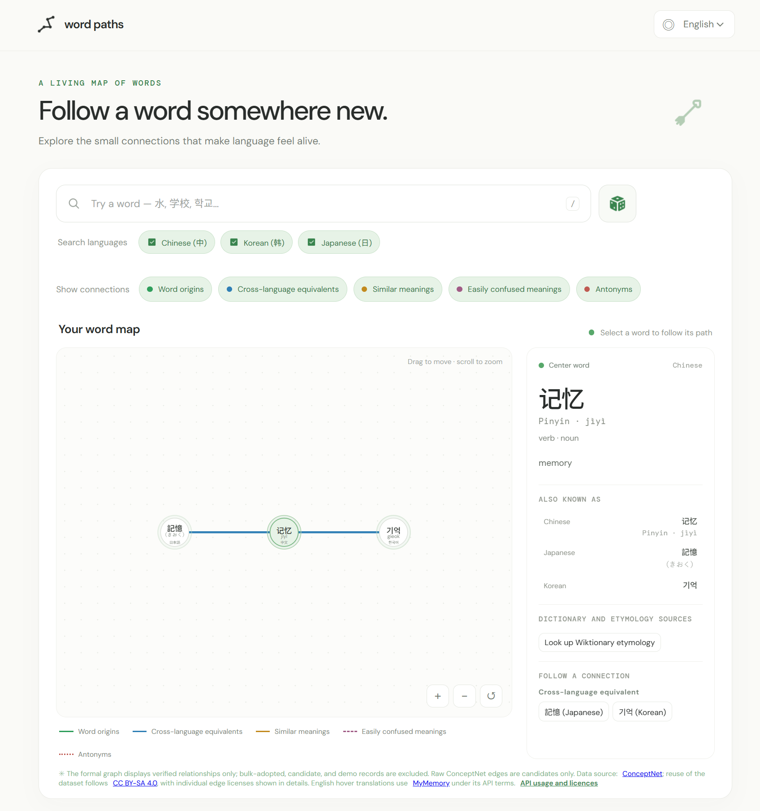
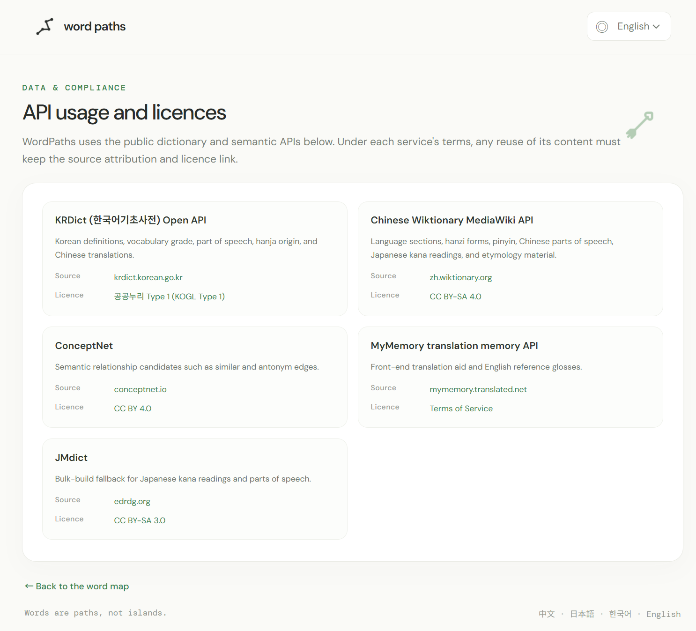

# Word Paths

Word Paths is an interactive web experience for exploring relationships between Chinese, Japanese, and Korean words that use Chinese characters. Instead of treating each word as an isolated dictionary entry, it presents related words as a visual network that users can explore by searching, filtering relationships, and selecting nodes.

**Course:** SD5913 — Interactive Experience  
**Project type:** Individual project  
**Status:** Done



*Main interface: search, language selection, relationship filters, the word graph, and the word detail panel.*



*API usage and licences page: source attribution and licence terms for the connected APIs.*

## The Idea

Word Paths is designed mainly for native Chinese speakers who are learning Japanese or Korean, as well as people interested in comparing vocabulary across these languages. Similar-looking words can have different meanings, readings, or usage. A relationship graph makes these connections easier to notice and investigate.

The experience focuses on the relationship between words rather than on providing a complete dictionary. The available vocabulary and relationships are limited by the data sources that can be accessed and verified during the project.

## Main Interaction

The intended interaction loop is **search or discover → inspect relationships → select a related word → explore again**.

- **Start exploring:** The page loads an available starting word and its connected words.
- **Search:** Enter a word to find matching entries in the available dataset. Chinese and Japanese searches for the same written form should show language labels so users can distinguish the entries.
- **Explore randomly:** Use the dice button to discover another available word.
- **Filter relationships:** Show or hide relationship categories to focus on the connections that matter.
- **Follow a connection:** Select a related word to make it the new focus of the graph.
- **Check a translation:** Hover over a word to see an English helper translation when one is available.
- **Change the interface language:** The interface supports Chinese, English, Japanese, and Korean. This changes the interface text, not the dictionary scope: the core vocabulary remains Chinese, Japanese, and Korean.
- **Understand the data scope:** The page reports the actual number of available entries and relationships, with a note that coverage is limited.

The graph separates cross-language equivalents from semantic relationships. Semantic relationships are etymology, similar meaning, easily confused, and antonyms. Corresponding words across Chinese, Japanese, and Korean are not automatically synonyms. The production graph and its relationship statistics include only `verified` relationships. Existing `adopted` records are retained in the data with their batch metadata, but are excluded from both production and development graphs until individually verified.

## Preview


*Main interface: search, language selection, relationship filters, and the word graph.*


*API usage and licences: each connected API is listed with its source link and licence.*

## Run Locally

The project is a static web app built with HTML, CSS, and JavaScript. It uses local JSON data, so run it through a local HTTP server rather than opening `index.html` directly.

1. Clone or download this repository.
2. Open a terminal in `word-paths/`.
3. Copy `.env.example` to `.env` and set `KRDICT_API_KEY`. The local `.env` is ignored by Git.
4. Start the project's Python backend:

```bash
python server.py
```

5. Open [http://127.0.0.1:8000](http://127.0.0.1:8000) in your browser. If the port is occupied, set `WORDPATHS_PORT=8766` before starting the server and use that port in the URL.

`server.py` serves the app and makes provider requests from the backend. A generic static server or Live Server can display local data, but cannot provide the provider integrations or protect the KRDict key. The server binds to loopback only. No package installation is required.

No package installation or build step is required for the static version. If the project structure changes, update these instructions to match the final repository.

## Project Structure

The current structure is:

```text
word-paths/
├── index.html
├── api.html
├── css/
│   ├── styles.css
│   └── animations.css
├── js/
│   ├── app.js
│   ├── apiPage.js
│   ├── graph.js
│   ├── details.js
│   ├── i18n.js
│   ├── vocabularyApi.js
│   ├── wordRepository.js
│   ├── relationshipValidation.mjs
│   ├── sourceApi.js
│   └── auditCandidates.mjs
├── icon/
│   ├── Logo.svg
│   ├── Search.svg
│   ├── Dice.svg
│   ├── Arrow.svg
│   ├── Checked Checkbox.svg
│   └── Unchecked Checkbox.svg
├── data/
│   ├── words.json
│   ├── demo-relationships.json
│   ├── candidate-relationships.json
│   ├── krdict-enrichment.json       # created when Korean source lookups are saved
│   └── etymology-sources.json       # created when Wiktionary extracts are saved
├── server.py
├── source_apis.py
└── test_source_apis.py
├── pic/
├── README.md
└── PROCESS.md
```

## Data and Technical Notes

- The interface is built with native HTML, CSS, and JavaScript.
- SVG can be used to draw the word nodes and connecting lines.
- The local JSON dataset stores available word entries and their relationships.
- The local Python backend optionally queries KRDict. Set `KRDICT_API_KEY` in `word-paths/.env`; the key is never sent to the browser. Existing local vocabulary remains available without the key.
- ConceptNet or another external source may be unavailable or return errors. The app should continue to provide the local data experience where possible.
- English is used only as a helper translation; it is not a fourth core dictionary language.
- The dataset is intentionally small. Word Paths does not claim to cover all Chinese, Japanese, or Korean vocabulary. The current snapshot holds 930 word entries (310 each for Chinese, Japanese, and Korean) across 276 shared-hanzi concept clusters, with 849 `verified` relationships shown in the production graph.
- Individually reviewed relationships eligible for the production graph use `verified` status. The 2026-10-30 owner-authorized batch retains `adopted` status and `metadata.batchAdoption.individuallyReviewed: false`; these records are not claimed to have been individually reviewed and are currently excluded from all graphs and displayable relationship statistics. `candidate` records belong in `data/candidate-relationships.json`; `demo` fixtures belong in `data/demo-relationships.json` and are only included in local development mode; rejected records use `rejected` status and are never displayed.
- Relationship types are `equivalent` (cross-language correspondence) and the four semantic types `origin`, `similar`, `confusable`, and `antonym`. `directionality` is `directed` for `origin` and `symmetric` for the other four types.
- KRDict and Chinese Wiktionary lookups are on demand through `server.py`; they do not add graph nodes or formal relationships. Exact Korean-word matches are attached to the existing Korean word ID in `data/krdict-enrichment.json`. A KRDict speech-level suggestion is queued as `candidate` only when a definition explicitly names another existing Korean word and its register; no automatic verification or product-type mapping occurs.
- Wiktionary requests retrieve one title at a time and extract only the selected word's Chinese, Japanese, or Korean language section. Available etymology notes are stored separately in `data/etymology-sources.json` with the word ID, language, retrieval time, source URL, and CC BY-SA 4.0 attribution. Missing sections leave the existing word data unchanged.
- The details panel provides on-demand source lookup. The backend sets a descriptive `WordPaths/1.0` User-Agent for Wiktionary and follows the MediaWiki API etiquette guidance. Respect KRDict API terms and Wiktionary attribution/share-alike requirements when reusing retrieved text.

## Candidate relationship review

Add source-backed, unverified records to `word-paths/data/candidate-relationships.json` with a unique `id`, existing `sourceWordId` and `targetWordId`, `rawRelationType`, `productRelationType` (use `null` until a human assigns a product category), `directionality`, `verificationStatus: "candidate"`, a `source` label and URL, and a concise `description`. Do not infer a product relationship from a ConceptNet label or API success.

From the repository root, run the dependency-free checker with Node.js:

```bash
node word-paths/js/auditCandidates.mjs
```

The checker verifies endpoint IDs/languages, self-loops, duplicate IDs and relationships, allowed types/statuses, directionality, cross-language constraints, and source/description fields. A clean check is a structural check only: a person must still confirm the meaning, etymology, confusion risk, antonymy, or cross-language correspondence against the cited evidence.

After individual review, move an accepted record into the `connections` array of its source word in `word-paths/data/words.json`, assign its confirmed `productRelationType`, set `verificationStatus` to `verified`, and retain its evidence and raw source type. Existing bulk-adopted records use `verificationStatus: "adopted"` and explicit batch metadata; they remain stored but are not displayed unless individually reviewed and changed to `verified` based on that review. Move rejected records out of the candidate queue and preserve them with `verificationStatus: "rejected"` in the local relationship records if an audit trail is needed. Never copy candidate or demo data into production as verified without review. Run the checker again after editing the queue.

## Error Handling and Known Limitations

- **No search results:** Show a clear empty state and let the user edit the query or try another word.
- **No verified relationships:** Show the word without fabricating connections, and explain that no usable related data is available.
- **External API unavailable:** Do not let an unavailable service prevent the local dataset from loading.
- **Missing English helper translation:** Omit the translation rather than displaying guessed text.
- **Limited coverage:** The graph only reflects the entries and relationships currently available in the dataset. Some words may have few or no connections.
- **Relationship accuracy:** Similar written forms do not automatically mean words share the same meaning or origin. Relationship types should be shown only when supported by the available data.
- **Source API configuration:** If `KRDICT_API_KEY` is absent, KRDict lookup returns a configuration error and does not change local data. Provider failures or missing Wiktionary language/etymology sections preserve the existing vocabulary and relationships.

Run the source parser tests from the repository root with:

```bash
python -m unittest discover -s word-paths -p "test_*.py" -v
```

## Credits

Word Paths is an individual student project for SD5913. External APIs and datasets used, with their sources and licences:

- [KRDict (한국어기초사전) Open API](https://krdict.korean.go.kr/) — 공공누리 Type 1 (KOGL Type 1)
- [Chinese Wiktionary MediaWiki API](https://zh.wiktionary.org/) — CC BY-SA 4.0
- [ConceptNet](https://conceptnet.io/) — CC BY 4.0
- [MyMemory translation memory API](https://mymemory.translated.net/) — [Terms of Service](https://mymemory.translated.net/terms-and-conditions)
- [JMdict](https://www.edrdg.org/jmdict/j_jmdict.html) — CC BY-SA 3.0

The in-app [API usage and licences page](word-paths/api.html) presents the same attribution. Fonts are served by Google Fonts (DM Sans, DM Mono, Noto Sans SC/JP/KR). The icons in `word-paths/icon/` were drawn for this project.

## Development Process

See [`PROCESS.md`](PROCESS.md) for the starting idea, implementation decisions, user trial, iteration, and disclosure of AI tools used. This file should be completed with the actual testing observations and decisions before submission.

## Project Links

- **GitHub repository:** https://github.com/sevenxyt48/Ash-Repo-Assignment3-WordPaths
- **Live demo:** Add a deployed URL if available.
- **Course:** SD5913 — Interactive Experience
